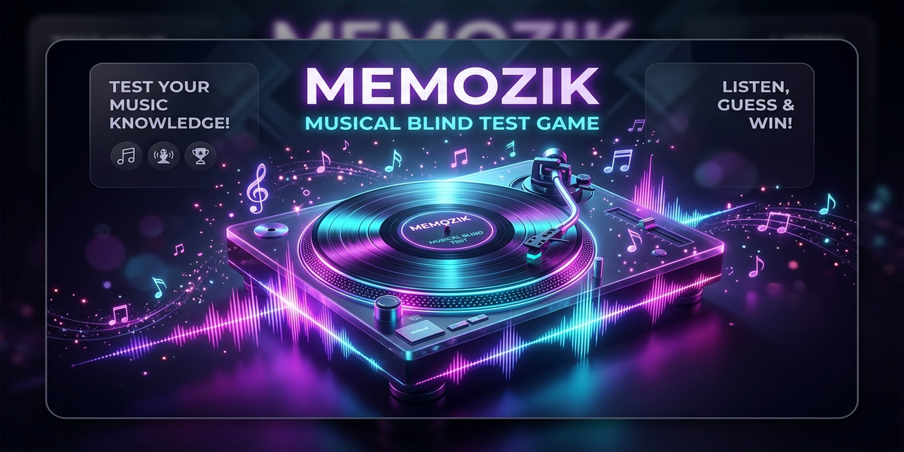

# MemoZik 🎵 — Le Grand Blind Test Musical

<p align="center">
  
</p>

> **MemoZik** est un jeu interactif et éducatif de mémoire auditive et de reconnaissance musicale (blind test), conçu dans le même esprit que **MemoFrance**, **MemoMonde** et **MemoChampi**.

🎮 **Jouer en ligne directement :** [https://chouteau.github.io/memozik/](https://chouteau.github.io/memozik/)

Testez votre oreille musicale sur une session de **20 propositions** : écoutez des extraits de mélodies légendaires tournant sur une platine vinyle animée, analysez le rythme, les instruments et les harmonies, puis identifiez le compositeur et le titre parmi 4 propositions !

---

## 🌟 Points Forts & Fonctionnalités

- 🎼 **60 Chefs-d'œuvre mondiaux** :
  - **25 monuments de la Musique Classique & Baroque** : Beethoven (*Lettre à Élise*, *5e Symphonie*, *Ode à la joie*, *Clair de lune*), Mozart (*Marche turque*, *Symphonie n°40*), Bach (*Toccata et Fugue*, *Prélude*), Vivaldi (*L'Hiver*), Chopin (*Valse minute*, *Étude révolutionnaire*), Tchaïkovski (*1812*, *Casse-Noisette*), Ravel (*Boléro*), Debussy (*Clair de lune*, *Arabesque*), Rossini (*Guillaume Tell*, *Le Barbier de Séville*), Saint-Saëns (*Le Cygne*, *Danse macabre*, *L'Aquarium*), Satie (*Gymnopédie*), Schubert (*Ave Maria*), Rimski-Korsakov (*Le Vol du bourdon*), Brahms (*Danse hongroise*)...
  - **25 tubes légendaires Pop, Rock & Variété** : Queen (*Bohemian Rhapsody*, *Killer Queen*), The Beatles (*Yesterday*), Michael Jackson (*Billie Jean*, *Beat It*), ABBA (*Dancing Queen*), Pink Floyd (*Another Brick in the Wall*), Nirvana (*Smells Like Teen Spirit*, *Come As You Are*), Daft Punk (*Around the World*, *One More Time*, *Get Lucky*), A-ha (*Take On Me*), AC/DC (*Highway to Hell*, *Thunderstruck*), Guns N' Roses (*Sweet Child O' Mine*), Elton John (*Rocket Man*, *I'm Still Standing*), Oasis (*Wonderwall*), George Michael (*Careless Whisper*), Coldplay (*Viva La Vida*, *Clocks*), Green Day (*American Idiot*), Rick Astley (*Never Gonna Give You Up*), Leonard Cohen (*Hallelujah*)...
  - **10 thèmes cultes du Cinéma et des Jeux Vidéo** : Céline Dion (*Titanic*), Hans Zimmer (*Pirates des Caraïbes*), Ennio Morricone (*Le Bon, la Brute et le Truand*), Koji Kondo (*Super Mario Bros.*), *Tetris* (*Korobeiniki*), Metallica (*Nothing Else Matters*), Avicii (*Levels*), Dave Brubeck (*Take Five*), Adele (*Skyfall - 007*), Coolio (*Gangsta's Paradise*)...
- 🎧 **Synthétiseur Web Audio 100% natif & hors-ligne** :
  - Aucun plugin ni dépendance externe lourde : les fichiers MIDI sont parsés et synthétisés directement par l'API Web Audio du navigateur (piano, cordes, cuivres, basse, percussions).
  - Égaliseur de fréquences FFT dynamique en temps réel.
- 💽 **Platine Vinyle Graphique Réaliste** :
  - Disque vinyle aux microsillons brillants qui tourne en lecture fluide.
  - Bras de lecture (tonearm) avec diamant qui se pose sur le disque.
  - Commandes audio complètes : Play/Pause, Replay au début, curseur temporel (timeline) et réglage de volume.
- 📚 **La Musicothèque (Encyclopédie des 60 morceaux)** :
  - Accessible à tout moment pour explorer et écouter n'importe quel morceau.
  - Recherche instantanée par titre, compositeur, style, époque ou année.
  - Filtres par univers : Tous, Classique, Pop/Rock, Cinéma & Jeux.
- 💡 **Fiches culturelles & Anecdotes** :
  - Après chaque proposition, découvrez une fiche détaillée et une anecdote passionnante (*« Le saviez-vous ? »*) sur l'histoire secrète du morceau et sa création.
- 📊 **Bilan & Révision de Session** :
  - Note sur 20, pourcentage et temps écoulé.
  - Rangs attribués selon les performances (de *Apprenti Mélomane* à *Virtuose Absolu* 🏆).
  - Récapitulatif interactif permettant de réécouter chaque morceau joué lors de la session.
- ⌨️ **Raccourcis Clavier complets** :
  - `1`, `2`, `3`, `4` : Sélectionner une proposition
  - `Espace` : Lancer la lecture / Mettre en pause
  - `R` : Rejouer l'extrait depuis le début
  - `Entrée` ou `N` : Passer au morceau suivant
  - `Échap` : Fermer la Musicothèque
- 🌓 **Thème Sombre & Thème Clair** avec mémorisation automatique des préférences et des statistiques personnelles.

---

## 🚀 Lancement & Utilisation

Le projet est en **HTML5 / CSS3 / JavaScript Vanilla**. Aucun serveur d'application ni configuration n'est nécessaire.

Double-cliquez simplement sur `index.html` pour ouvrir le jeu dans votre navigateur web habituel (Google Chrome, Microsoft Edge, Mozilla Firefox, Safari) !

```bash
# Ou via un serveur local de développement :
python -m http.server 8000
# Ouvrir ensuite http://localhost:8000
```

---

## 📁 Architecture des Fichiers

```
MemoZik/
├── index.html          # Structure de l'application & SEO
├── style.css           # Système de design Glassmorphism & Platine vinyle
├── app.js              # Moteur de jeu interactif & boucle de session
├── sound.js            # Synthétiseur Web Audio API & effets sonores
├── tracks.js           # Base de données des 60 morceaux avec séquences audio
├── build_data.py       # Script d'extraction et de construction des données
├── favicon.svg         # Icône SVG vinyle & note de musique
├── midi/               # Répertoire des 60 fichiers MIDI d'origine
└── README.md           # Documentation du projet
```

---

## 🎼 Licence & Crédits

- Développé par **Marc Chouteau**.
- Fichiers musicaux MIDI sous licences libres et du domaine public.
- Synthèse sonore 100% JavaScript via Web Audio API.
